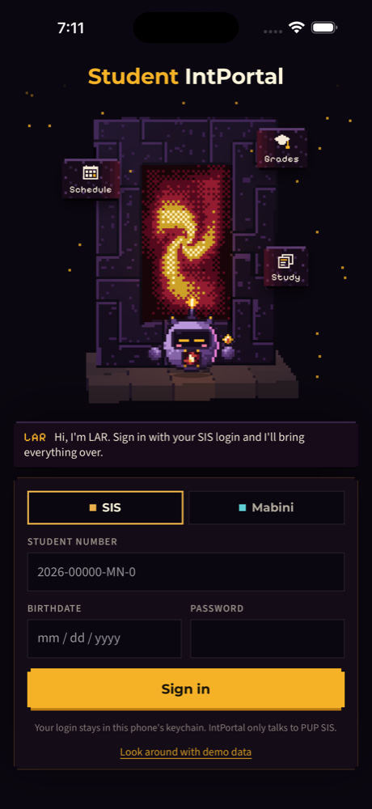
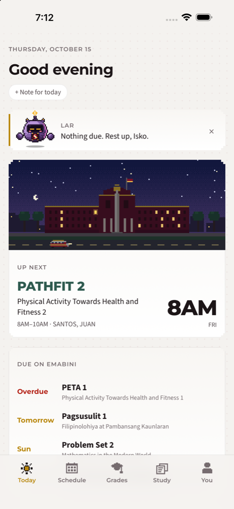
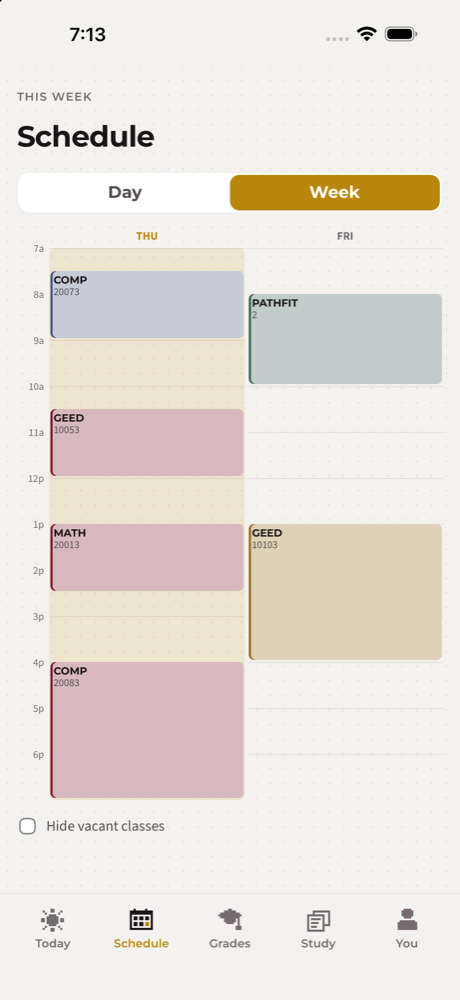
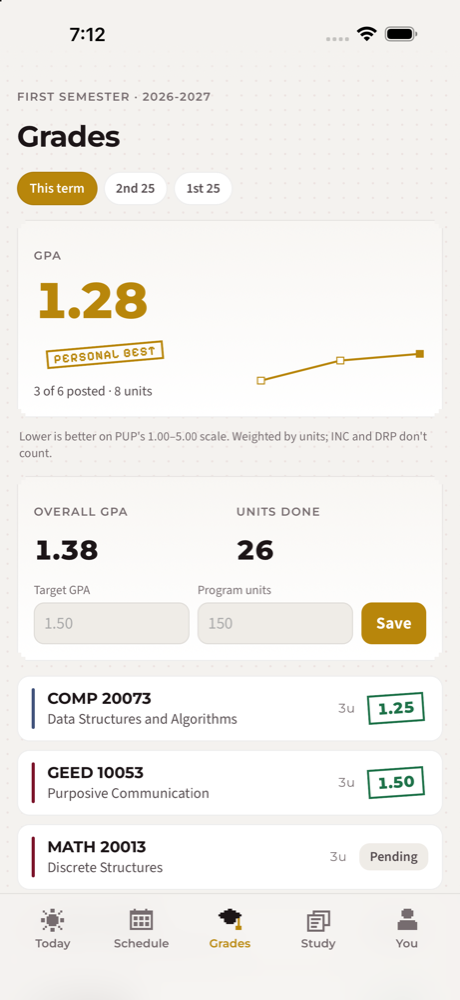
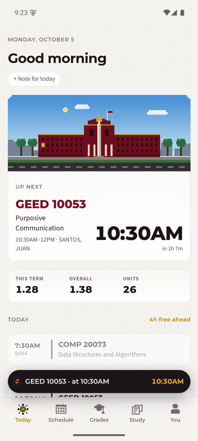
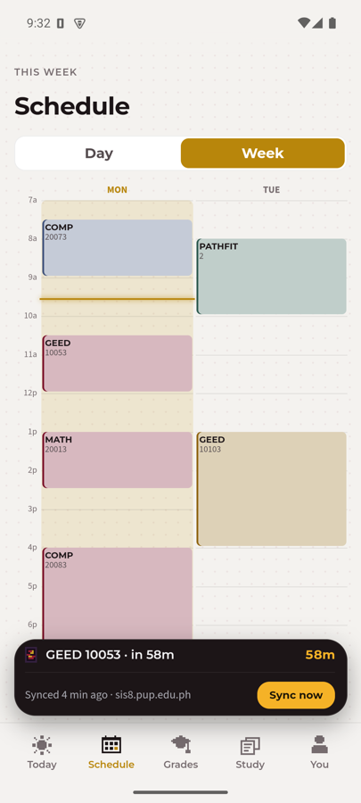

# IntPortal

[](CHANGELOG.md)
[](https://github.com/cGradying/intportal-app/actions/workflows/ci.yml)
[](https://github.com/cGradying/intportal-app/actions/workflows/ios.yml)

[](LICENSE)

An unofficial student app for PUP, built for phones. It signs in to PUP's systems with your own account (the SIS for classes and grades, eMabini for courses and deadlines), keeps the data on the phone, and adds study tools and an on-device assistant around it. The look is a calm, clean interface with crafted pixel-art moments. LAR, the Lakbay-Aral Robot, does the talking. Isko is you.

It is a from-scratch rebuild of the macOS app, [cGradying/IntPortal](https://github.com/cGradying/IntPortal), which is now in maintenance. The old app's docs live in `docs/legacy/`; [docs/specs/](docs/specs/README.md) tracks what moves over.

IntPortal is not made by or affiliated with PUP. Only your own account is supported, on the SIS and on eMabini, which is what PUP's terms allow. There are no store releases yet: build it yourself with the steps below.

Every feature, tab by tab, is in [docs/FEATURES.md](docs/FEATURES.md); what changed in each version is in [CHANGELOG.md](CHANGELOG.md).

<p>
  
  
  
  
</p>
<p>
  
  
  
</p>

## What it does

- **Portals.** Pick SIS or Mabini (PUP's eMabini learning system) on the landing. Each has its own login, limits and colours; you can use one or both.
- **Today.** Up next with a countdown, today's classes with the free time between them, your GPA at a glance, deadlines due soon, and one nudge from LAR.
- **Schedule.** Day and week views. Long-press a class to mark it vacant or online, move it for a week, colour it, or add a note.
- **Grades.** Every term with a real GPA, goals, and what you need on the rest to reach a target.
- **Study.** Flashcard decks scheduled by FSRS, with three ways to study and a daily streak.
- **Syllabus and notes.** Paste a course outline to track quizzes and exams, and keep notes per class or per day.
- **Mabini.** Your eMabini courses, the deadlines from every course on Today, and course grades next to the SIS ones.
- **IntAssis (optional).** LAR answers questions about your classes, grades, deadlines and notes with a small model that runs on the phone, and says which notes an answer came from. Ask AI inside a note summarizes, tidies or explains it; it can also make flashcards from a note and explain a wrong answer. You download the model only if you choose "With AI" at first run. Nothing it suggests changes until you confirm.
- **Reminders.** Before each class, the evening before deadlines, and on study days.
- **On the phone itself.** A Live Activity for the next class on Dynamic Island iPhones; on Android, which has no Dynamic Island, a Live Update counting down in the status bar. A home-screen widget on both. An IntPortal calendar in the phone's calendar holds your classes, and your own events show on Today and Schedule as busy time.
- **Sign-in guard.** One sign-in per tap, at most three tries in 15 minutes per portal, and no automatic retry after a rejected password, so the app can't get your PUP account locked.
- **Privacy.** Everything stays on the phone, including the AI. Your SIS login is in the keychain (the Android Keystore on Android). Each student's data is its own SQLCipher-encrypted file, with its key in the keychain. A Face ID or fingerprint app lock is optional.

## Stack

- **Core.** Rust, in `crates/intportal-core`: the portal registry, the SIS and eMabini clients and parsers, the sign-in guard, schedule and grade logic, the coach, FSRS study scheduling, syllabus parsing, calendar events, and the encrypted SQLite store.
- **AI.** `crates/intportal-ai` (pure Rust: intents, prompts, schemas, RAG over notes, card and outline generation) and `crates/intportal-llm` (llama.cpp through `llama-cpp-2`, the model download and the memory gate). See [docs/ai.md](docs/ai.md) and [ADR 0003](docs/adr/0003-on-device-ai-llama-cpp.md).
- **Shell.** Tauri 2, in `src-tauri`, for iOS and Android. macOS and Windows build from the same code.
- **Interface.** Svelte 5 with SvelteKit's static adapter, in `src`. The landing's tile portal is Rust (`crates/intportal-tiles`) compiled to WebAssembly by `scripts/tiles.sh`; run `rustup target add wasm32-unknown-unknown` once ([ADR 0004](docs/adr/0004-landing-renders-in-rust-wasm-tiles.md)).
- **Native plugins.** Local plugins with a Swift and a Kotlin half live in `plugins/`: `tauri-plugin-glance` (widget, and the Live Activity or Live Update) and `tauri-plugin-calendar` (EventKit or CalendarContract).

## Layout

```
crates/intportal-core/   Rust core and its tests
crates/intportal-ai/     IntAssis logic, tested with a fake model
crates/intportal-llm/    llama.cpp, model download, memory gate
src-tauri/               Tauri shell: commands, keychain, store opening
src-tauri/gen/apple/     Xcode project, generated from project.yml by XcodeGen
src-tauri/gen/android/   Gradle project, from tauri android init (see docs/android.md)
plugins/                 Local Tauri plugins with Swift and Kotlin sources
src/                     Svelte interface (screens in src/lib/screens)
scripts/                 sim.sh, phone.sh, emu.sh, worktree.sh, version.sh, disk.sh, clean.sh, tiles.sh
spikes/                  Throwaway experiments (SIS over HTTP, llama.cpp)
docs/ARCHITECTURE.md     Layers, flows, owners and invariants: start here
docs/TEAM.md             Roles, the issue-to-merge loop, kickoff prompts
docs/adr/                Decisions that are hard to reverse
docs/specs/              What each screen must do, as numbered criteria
docs/ai.md               How IntAssis is built, measured and run
docs/FEATURES.md         Every feature, for students
docs/android.md          How the Android side is built, run and checked
CONTEXT.md               Glossary of the app's terms
PRODUCT.md, DESIGN.md    Product record and design system
CHANGELOG.md             What changed in each version
```

## Requirements

- macOS with Xcode and the iOS simulator runtime that matches it (`xcodebuild -downloadPlatform iOS`)
- Rust (stable) with the iOS targets: `rustup target add aarch64-apple-ios aarch64-apple-ios-sim`
- Node 22 and pnpm
- XcodeGen (`brew install xcodegen`)
- For Android: Android Studio with SDK 36, NDK r28 or newer and an emulator, JDK 17 (`brew install openjdk@17`), and `rustup target add aarch64-linux-android`

Then install the JavaScript dependencies:

```bash
pnpm install
```

## Run it

### Checks

```bash
pnpm check
pnpm test
cargo test -p intportal-core
```

CI runs the same on every pull request, plus clippy. Each push to `main` also builds the iOS simulator app.

### iOS simulator

```bash
scripts/sim.sh "iPhone 17 Pro Max"
```

The argument is a simulator name or id; with none, the booted simulator is used. The script builds the debug app, installs it and launches it. Tap **Look around with demo data** to skip sign-in, then **Step through**.

`pnpm tauri ios dev` can pick a real device with the same model name, which then needs signing, so prefer `scripts/sim.sh`.

### Your own iPhone

1. Sign in to Xcode with your Apple ID: Xcode → Settings → Accounts.
2. Unlock the phone, then run:

   ```bash
   APPLE_DEVELOPMENT_TEAM=<your team id> scripts/phone.sh
   ```

   `DEVICE=<name or id>` picks the phone. The script regenerates the Xcode project with your team, builds, installs over USB or Wi-Fi, and restores the committed project files.
3. The first time, trust the developer profile: Settings → General → VPN & Device Management.

A free Apple account works, with two limits. The app stops opening after 7 days, so run the script again to renew it. App Groups aren't available, so the home-screen widget can't show the next class; the Live Activity still works. With a paid account, add `--app-group`.

### Android emulator

```bash
scripts/emu.sh
```

With an emulator running (or a phone on USB), the script builds the arm64 debug APK, installs it and launches it. Tap the portal, then **Look around with demo data**, then **Step through**. Where each Android piece lives, what to check after a change and the problems already solved are in [docs/android.md](docs/android.md).

### Changing native settings

`src-tauri/gen/apple/project.yml` owns the Info.plist keys, entitlements and deployment target. After editing it, regenerate the project:

```bash
cd src-tauri/gen/apple && xcodegen generate
```

## Keep it small

Rust, Xcode and Gradle builds grow fast; this project once reached hundreds of GB of caches.

- All crates share one Cargo workspace: one `target/` and one `Cargo.lock` at the root. Don't add a crate outside `[workspace] members`.
- Every worktree shares one Cargo build cache in `~/.cargo/build/intportal` (`.cargo/config.toml`), so a new worktree doesn't compile the dependencies again. Each keeps its own `target/` for the final app.
- Dev builds keep line tables only (`[profile.dev]` in the root `Cargo.toml`). Never set `debug = false` for dependencies, because the iOS link then fails.
- `scripts/disk.sh` prints what the builds use. `scripts/clean.sh` deletes this repo's `target/`, the shared build cache, the Xcode and Gradle build folders and this project's DerivedData, and nothing else.
- Never commit build output. Stage paths by name, not `git add -A`.

## Contributing

Work is split by role; `docs/TEAM.md` has the roles, the loop and the review checklist. Each change is its own issue, branch and pull request. Write the failing test first where a cheap test exists, then the change. Check UI changes on the iOS simulator, and on the Android emulator when they touch Android. Use the terms in `CONTEXT.md`. Record a hard-to-reverse decision as an ADR in `docs/adr/`.

## License

[PolyForm Noncommercial 1.0.0](LICENSE): free to read, run and change for noncommercial use. IntPortal is an independent student project and is not affiliated with Polytechnic University of the Philippines.
